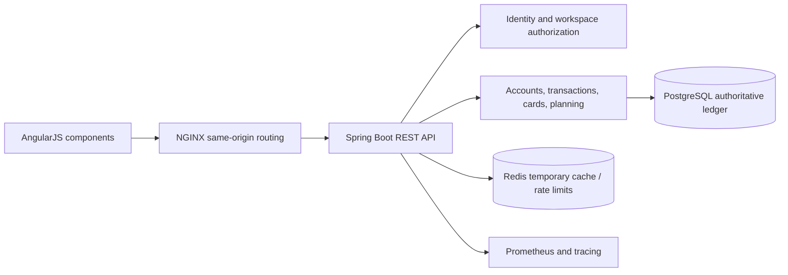
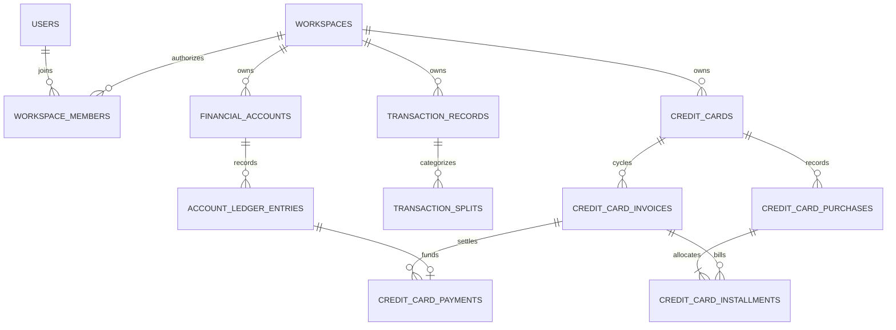

# Architecture

The target is a modular monolith. Module packages contain `domain`, `application`, `infrastructure`, and `presentation` as their implementation arrives. Domain code has no framework dependencies. Application services own transaction boundaries; presentation accepts validated DTOs; infrastructure owns persistence and adapters.



The diagram describes the target. Backend identity/workspace source, SMTP outbox delivery and the AngularJS access/workspace flow now exist. Financial modules and runtime integration validation remain pending.

| Boundary | Responsibility | Published interface |
| --- | --- | --- |
| Identity/users | Credentials, verification, token rotation, profile, suspension | Authenticated principal and session lifecycle |
| Organizations/workspaces | Membership, roles, personal/business isolation | Workspace authorization guard |
| Accounts/transfers | Immutable cash ledger, reconciliation, atomic transfers | Posting commands and balance queries |
| Transactions/categories | Recognition, settlement, recurrence, classification, splits | Financial commands and filtered projections |
| Credit cards/invoices | Purchases, exposure, installments, invoices, payments, refunds | Liability and payment commands |
| Budgets/goals | Planning, thresholds, earmarked savings | Planning projections |
| Reports/dashboard/exports | Cash/accrual views, bounded exports, charts | Read-only projection DTOs |
| Audit/notifications | Durable audit and idempotent reminders | Internal events after successful mutation |

Cross-module references use identifiers and explicit application interfaces. Avoid cross-module repository access from controllers. Financial changes and their audit records commit together. Notifications use a durable database outbox/job record; Redis loss cannot remove financial facts.

## Target relationships



V1 contains identity, roles, workspaces, membership, refresh-token and audit tables. V2 adds sessions, one-time challenges, email outbox and rate-limit counters. Financial migrations will add composite tenant foreign keys: `(workspace_id, account_id)` must reference an account in that same workspace, with equivalent constraints for cards, categories and invoices.

## Repository

```text
backend/                   Maven application, domain rules, Flyway, tests, Dockerfile
frontend/                  AngularJS components, API service, styles, tests and NGINX
scripts/                   Dependency-free Java checks and development key generation
docs/                      Actual verification and implementation status
.github/workflows/         Foundation verification
compose.yaml               Local PostgreSQL, Redis and backend
```

Kubernetes and Helm source will be added after dependent phases validate. Frontend identity components call real backend routes, but the browser/backend integration has not yet executed. No fabricated financial dashboards represent completed features.
